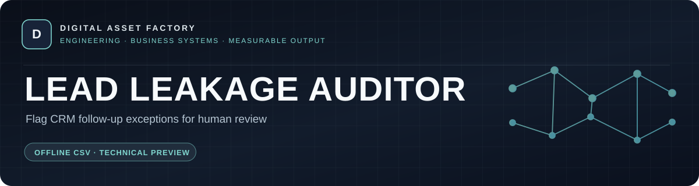
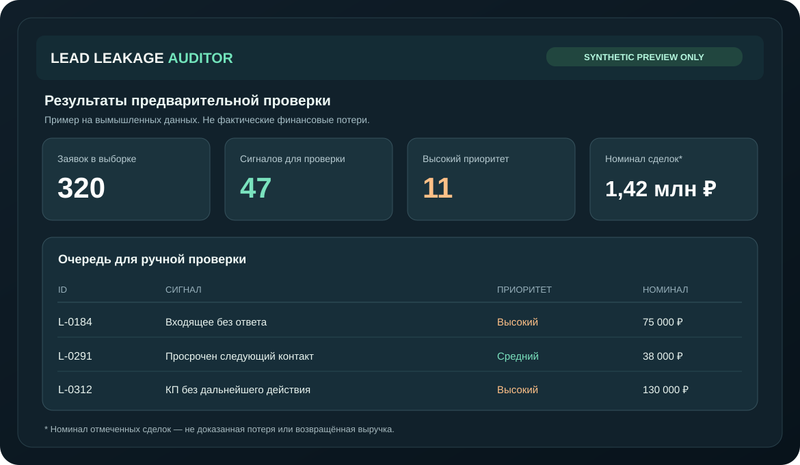

# Lead Leakage Auditor
**Spot CRM workflow exceptions. Verify findings before calling them revenue leakage.**

[**Explore presentation**](index.html) · [**Free self-check**](docs/CRM-LEAD-LEAKAGE-SELF-CHECK.md) · [**Product scope**](docs/PRODUCT_SCOPE.md) · [**Commercial discussion**](docs/COMMERCIAL_OPTIONS.md) · [**Contact privately**](mailto:agenticcommerce975@gmail.com?subject=Lead%20Leakage%20Auditor%20Inquiry) · [**Русский**](#на-русском)

> **Technology status:** Offline, private browser-based CSV prototype tested with synthetic cases. Not a live CRM integration, production SaaS, independently certified solution or proven revenue-recovery service.

| Built for | What it can flag | How results are used |
| :--- | :--- | :--- |
| Revenue operations, sales managers and CRM integrators | Unanswered inquiries, overdue next actions and stalled open opportunities in authorized CSV exports | Prioritized **human review**; thresholds and findings must be verified against the customer's workflow |

**Free practical resources:** [Five CRM checks](docs/CRM-LEAD-LEAKAGE-SELF-CHECK.md) · [Seven false positives](docs/CRM-LEAD-LEAKAGE-FALSE-POSITIVES.md) · [Buyer checklist](docs/BUYER_CHECKLIST.md)

**Related engineering work:** [Agentic Commerce — public integration showcase](https://github.com/alexgeractor-web/agentic-commerce-public-show-case) · [Digital Asset Factory portfolio](docs/GITHUB-PROFILE-README.md)

---

## Free practical guide

[**CRM lead leakage: a 10-minute self-check (EN / RU)**](docs/CRM-LEAD-LEAKAGE-SELF-CHECK.md) — five verifiable workflow checks, a privacy-first review method and clear limitations. No signup or customer data required.

## Avoid false positives before claiming revenue leakage

[**7 common CRM alert false positives (EN / RU)**](docs/CRM-LEAD-LEAKAGE-FALSE-POSITIVES.md) — a free, privacy-first validation checklist for RevOps and CRM integrators. Examples are synthetic; no client outcomes or recovered revenue are claimed.

## Problem and solution

Sales teams may miss incoming inquiries, delay proposals or forget promised follow-ups. LEAD LEAKAGE AUDITOR helps review **one authorized CRM export in CSV format**, without requiring a CRM password or a live API connection.

The private offline prototype uses deterministic rules to:
- highlight unanswered incoming inquiries and late callbacks;
- flag unanswered quotations, overdue actions and inactive open opportunities;
- create a prioritized **human review** list and export it as CSV;
- show the **nominal value of flagged RUB opportunities**, **not** verified lost profit or recovered revenue.

**Status:** working private browser-based prototype; automated tests passed for synthetic cases. **No confirmed real customer deployment, CRM sync, SaaS hosting, autonomous AI, guaranteed increased revenue or independent security certification.**

The public showcase does **not** publish proprietary software source, customer records, vendor keys or executable commercial core. This graphic is illustrative **synthetic data**, not client results.

## Ways to evaluate
- [View a static public presentation](index.html) and [technical scope](docs/PRODUCT_SCOPE.md).
- [Discuss a diagnostic service](docs/COMMERCIAL_OPTIONS.md), provisional **from 19,000 ₽** for a tightly bounded review and **from 39,000 ₽** for an expanded assessment, only after feasibility and scope approval.
- [Ask a public, non-confidential question](https://github.com/alexgeractor-web/lead-leakage-auditor-showcase/issues/new?template=buyer-inquiry.yml).
- [Request a private business discussion](mailto:agenticcommerce975@gmail.com?subject=Lead%20Leakage%20Auditor%20Inquiry). **Do not email CSV exports, customer data, passwords or private diagrams unprotected.**
- Licensing, white-label and asset acquisition are discussed individually, conditional on due diligence and agreement.

## Security and IP
This repository is deliberately PUBLIC. Any material uploaded here is visible and may be copied. The commercial code is maintained separately in a **PRIVATE** repository. The documents are published for evaluation only; no open-source license is granted. See [LICENSE](LICENSE) and [SECURITY.md](SECURITY.md).

## На русском

**LEAD LEAKAGE AUDITOR** — программа для предварительной диагностики необработанных заявок, просроченных задач и забытых коммерческих предложений по выгрузке CRM в CSV. Её задача — **выделить записи для ручной проверки**, а не объявлять номинальную сумму сделки фактической потерей.

На данном этапе это проверенный на тестовых сценариях **локальный прототип**. Прямого подключения к CRM, реальных кейсов возврата выручки и облачной подписки пока нет. Исходное коммерческое ядро не публикуется.

**Условные стартовые бюджеты:** ограниченная диагностика — от **19 000 ₽**, расширенный аудит — от **39 000 ₽**. Это **ценовые гипотезы, не публичная оферта**, и они не означают подтверждённого спроса или окончательного расчёта. Точные условия — после изучения задачи и договора.

**Для покупателей:** [задать вопрос публично](https://github.com/alexgeractor-web/lead-leakage-auditor-showcase/issues/new?template=buyer-inquiry.yml) или [написать приватный коммерческий запрос](mailto:agenticcommerce975@gmail.com?subject=Lead%20Leakage%20Auditor%20Inquiry). Данные реальных клиентов в GitHub Issues не размещайте.

© 2026. All rights reserved.
